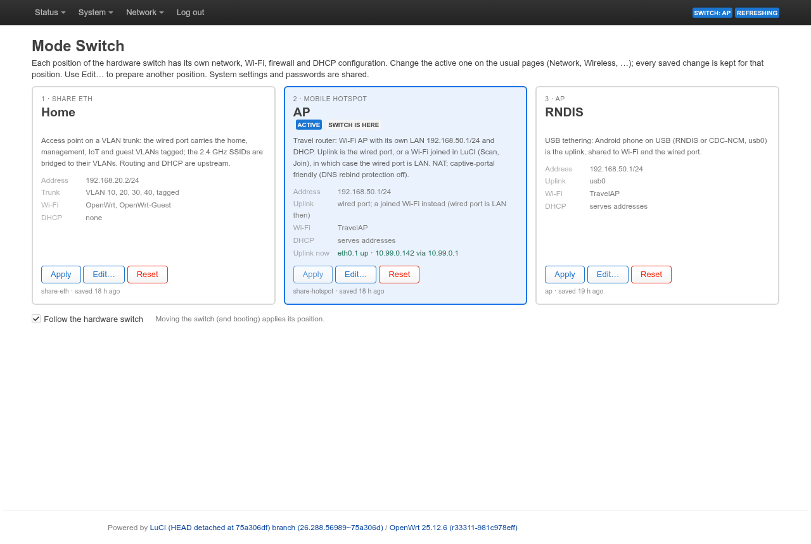

# wr902ac-openwrt-debloat

An OpenWrt 25.12 build for the **TP-Link TL-WR902AC v3** travel router
(MT7628NN, 64 MiB RAM, 8 MiB flash, MT7610EN 5 GHz, one 10/100 port, USB,
three-position mode switch).  It turns a board that randomly rebooted under
load into a stable router with three times the free memory.  Each position
of the hardware switch selects a configuration: a VLAN-trunk access point,
a travel router, and USB tethering.

The build is stock OpenWrt v25.12.6 plus:

- **seven patches** (`patches/openwrt/`): smaller DMA rings and printk
  buffer, a TXQ limit that scales with RAM, the mt7603 power-save fixes, and
  per-service OOM priorities;
- **a low-memory configuration** (`config/diffconfig`, `files/`): sysctl
  watermarks, 128 KiB squashfs blocks, no package manager, no IPv6
  userspace, full wpad, LuCI over HTTPS;
- **two packages** (`feed/`): `modeswitch`, a configuration profile per
  switch position, and `luci-app-modeswitch`, its LuCI page.

## Results

Measured on a TL-WR902AC v3; the details are in [docs/memory.md](docs/memory.md).

| | OpenWrt 24.10.1 | this build |
|---|---|---|
| MemAvailable, idle, one Wi-Fi client | 12.0 MB | 39.0 MB |
| SUnreclaim | 7.8 MB | 4.2 MB |
| 92 Mbit/s UDP flood, 45 s | OOM: collectd, hostapd and rpcd killed, Wi-Fi down | no OOM, no service restarted |
| Bridged TCP, port ↔ 2.4 GHz | 89–94 Mbit/s | 93.5–93.7 Mbit/s |
| NAT TCP, software flow offloading | 94.1 Mbit/s | 89–93 Mbit/s |
| sysupgrade image | 6016 KB (stock 25.12.6) | 6016 KB, about 1.7 MB left for the overlay |

The random reboots came from the kernel's watermark boost.  It raised the
minimum free-memory watermark to 24.5 MB on a 58 MB system, so the OOM
killer ran while 14.6 MB were still free.  `vm.watermark_boost_factor=0`
alone gave 12 MB back.

## Mode switch

| Switch | Alias | Configuration |
|---|---|---|
| 1, *Share ETH* | **Home** | 2.4 GHz access point on a VLAN trunk: home, management, IoT and guest VLANs tagged on the port, SSIDs bridged to their VLANs; routing and DHCP upstream. |
| 2, *Mobile Hotspot* | **AP** | Travel router: Wi-Fi AP with its own LAN (192.168.50.1/24, DHCP).  The uplink is the cable, or a Wi-Fi network joined in LuCI, which turns the port into a LAN port.  Captive portals work. |
| 3, *AP* | **RNDIS** | USB tethering: an Android phone (RNDIS or CDC-NCM) is the uplink for Wi-Fi and the port. |

Configure the active position on the usual LuCI pages; every saved change is
kept for that position.  *System → Mode Switch* shows all positions, applies
them, and edits the inactive ones.



How to use it: [docs/guide.md](docs/guide.md).  How it works:
[feed/README.md](feed/README.md).

## Build

```
scripts/build.sh [openwrt-dir]
```

clones OpenWrt at the version in `config/openwrt-version` (default
`./openwrt`), applies `patches/openwrt` with `git am`, adds `files/` and the
local feed, expands `config/diffconfig` and builds.  The image is in
`openwrt/bin/targets/ramips/mt76x8/`.  The OpenWrt build prerequisites are
needed.

Releases (tags `v*`) are built by GitHub Actions and carry the image,
`sha256sums`, the manifest, the `*.buildinfo` files and a build provenance
attestation.

## Install

- **From OpenWrt:** `sysupgrade` with the `*-squashfs-sysupgrade.bin`.
  Keep the settings only when coming from this build.
- **From the stock firmware:** follow the TL-WR902AC v3 page of the OpenWrt
  wiki, with the `*-squashfs-tftp-recovery.bin` of this build.

After the first boot:

1. Set up Wi-Fi and a root password in LuCI (HTTPS; HTTP redirects).
2. Before using the Home position, set its keys:
   `uci set modeswitch.share_eth.home_key=…; uci set modeswitch.share_eth.guest_key=…; uci commit modeswitch`.
   The VLAN IDs, SSIDs and management address are in the same section.
3. Move the switch.  The first time a position is used, its profile is built
   from the configuration at that moment.

To reach the device by cable, use the RNDIS position (192.168.50.1).
OpenWrt failsafe works as usual.

## Development

```
scripts/lint.sh     shellcheck (busybox ash), LuCI JavaScript, JSON
tests/run.sh        modectl tests in an OpenWrt rootfs container
```

CI (`.github/workflows/ci.yml`) runs both.  It also applies the patches to
the pinned OpenWrt release and builds the packages with the OpenWrt SDK.  A
weekly job checks the patches against newer releases of the branch.  What
was tested on hardware, and what was not, is in
[docs/testing.md](docs/testing.md).

Commits follow the OpenWrt style (`component: summary`, `Signed-off-by`);
AI assistance is declared with `Assisted-by`.

## Licence

GPL-2.0-or-later; documentation CC-BY-4.0; the OpenWrt patches carry the
licences of the files they change.  See [LICENSE](LICENSE).
