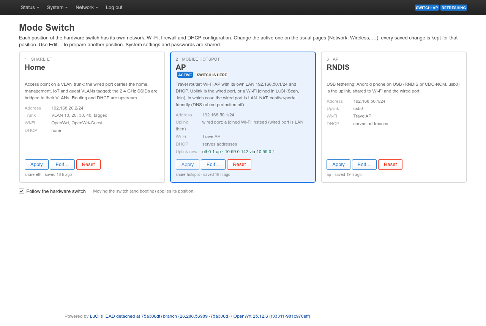
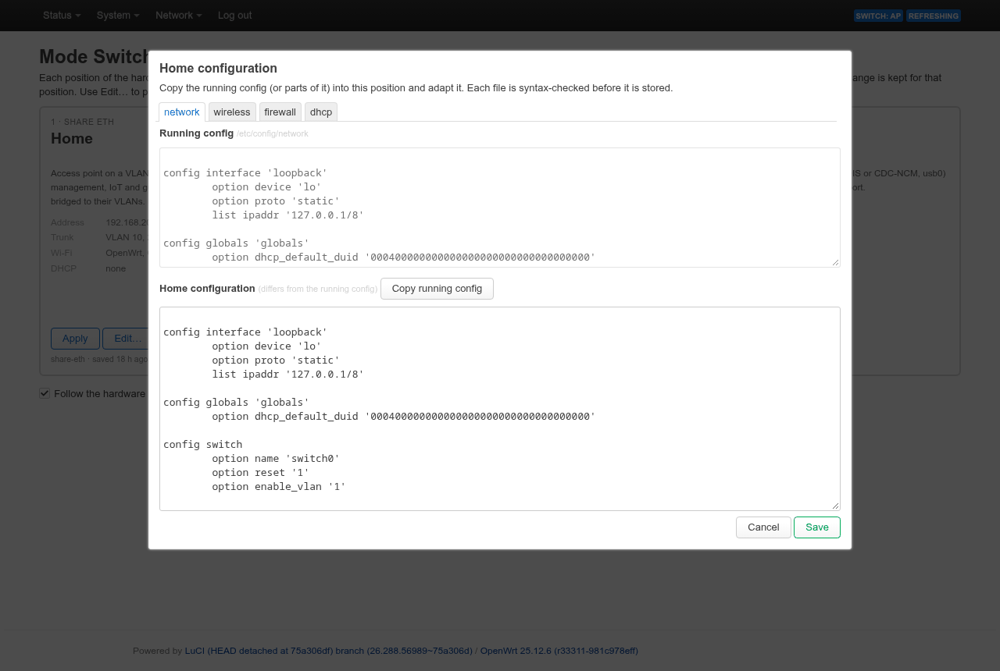
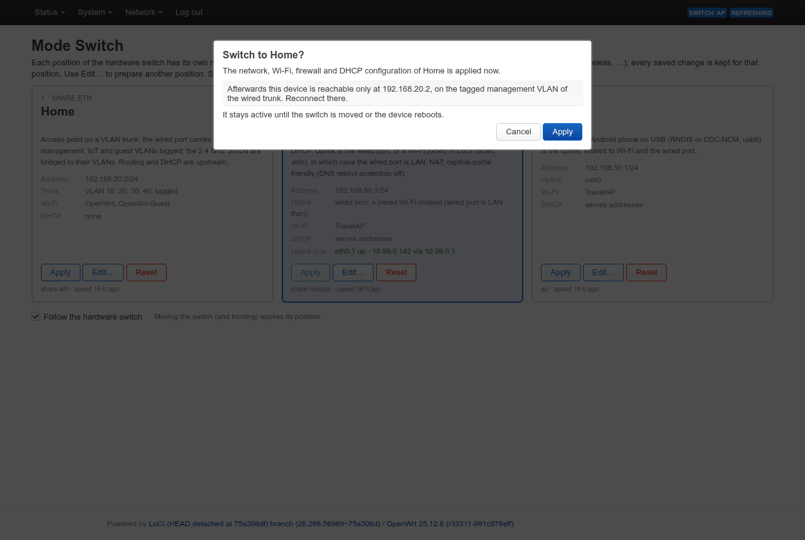
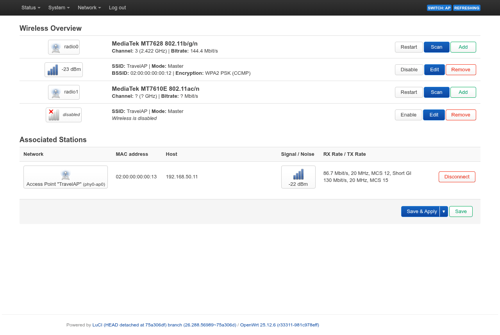
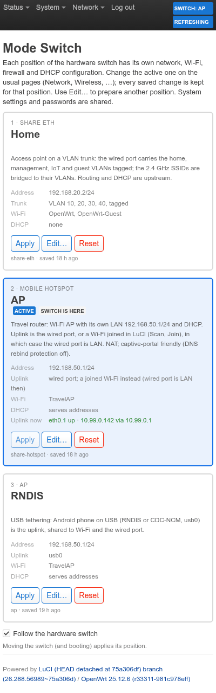
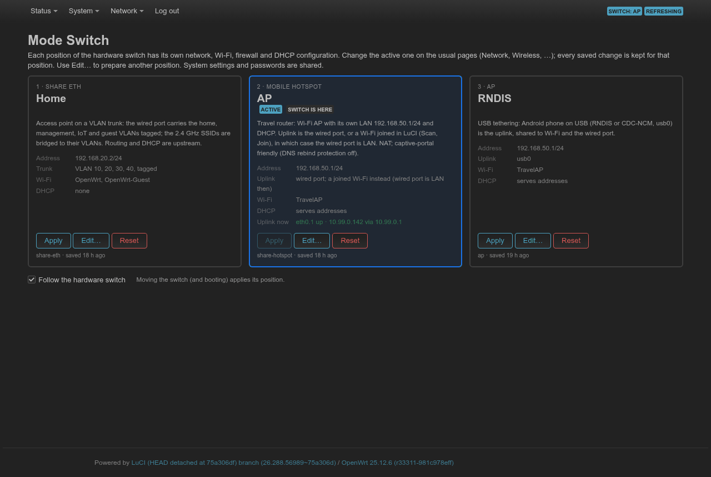
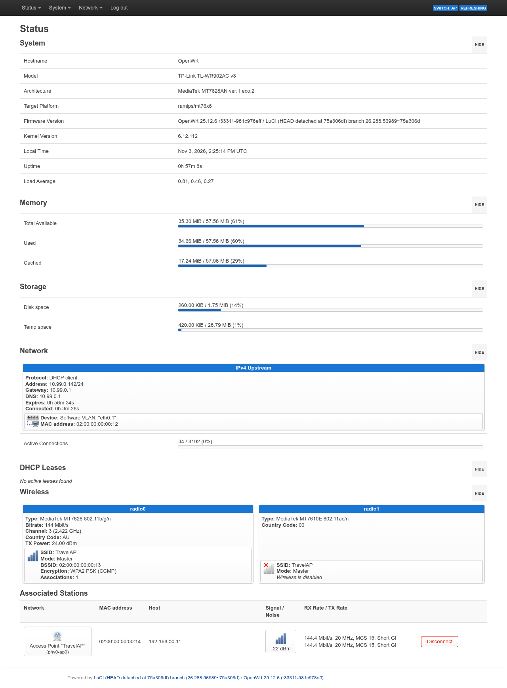

# User guide

How to use the TL-WR902AC v3 with this build.  The screenshots come from a
device with a demo configuration (SSID `TravelAP`, the Home defaults); MAC
addresses and device IDs are masked.

## The three positions

The slide switch on the side of the device selects the configuration.
Every position has its own network, Wi-Fi, firewall and DHCP settings.
System settings, passwords and LuCI are shared.

| Switch | Alias | Use it for | The device is at |
|---|---|---|---|
| 1, *Share ETH* | **Home** | an access point at home, on a VLAN trunk | its management address (192.168.20.2 by default), on the management VLAN |
| 2, *Mobile Hotspot* | **AP** | travelling: hotel cable or hotel Wi-Fi as the uplink | 192.168.50.1 |
| 3, *AP* | **RNDIS** | an Android phone on USB as the uplink | 192.168.50.1 |

*System → Mode Switch* shows all three.  The outlined tile is where the
switch is, the filled one is the active configuration, and the header of
every LuCI page shows the switch position:



Each tile summarises its configuration: addresses, uplink, trunk VLANs,
SSIDs and DHCP.  The active tile also shows the live uplink state.

## First setup

1. Flash the image (see the [README](../README.md#install)) and open LuCI
   over HTTPS.  The certificate is self-signed; HTTP redirects to HTTPS.
2. Set a root password (*System → Administration*) and the Wi-Fi network
   (*Network → Wireless*).  Positions built later take their Wi-Fi name and
   key from the configuration at that moment.
3. Before using Home, give it its Wi-Fi keys and, if the defaults do not
   fit, its VLANs, SSIDs and management address:

   ```
   uci set modeswitch.share_eth.home_key='…'
   uci set modeswitch.share_eth.guest_key='…'
   uci set modeswitch.share_eth.vlan_home='10'   # vlan_mgmt, vlan_iot, vlan_guest
   uci set modeswitch.share_eth.home_ssid='…'    # guest_ssid, mgmt_ip, mgmt_gw
   uci commit modeswitch
   ```

   Without the keys the Home profile cannot be built.  The device then
   keeps the configuration it had, OpenWrt's 192.168.1.1 on a fresh
   install.
4. Move the switch.  The first time a position is used, its profile is
   built from its template; after that, it is never overwritten.

## Changing settings

Change the active position on the usual LuCI pages: *Network → Interfaces*,
*Network → Wireless*, *Network → Firewall*, *Network → DHCP and DNS*.  Every
*Save & Apply* is also saved into that position's profile, and it comes
back the next time the switch is set there.

To prepare another position without switching to it, use **Edit…** on its
tile.  Every file is shown twice: the running configuration (read-only) and
the position's configuration (editable).  *Copy running config* copies the
former into the latter.  A file with a uci syntax error is refused.



**Apply** switches to a position now, until the switch is moved or the
device reboots.  The confirmation says where the device will be reachable
afterwards:



**Reset** rebuilds a position from its template; your changes in that
position are lost.  If the template cannot run (for example, Home without
keys), the old profile is kept.

Untick **Follow the hardware switch** to ignore the switch; positions are
then applied from this page only.

## Travelling (AP)

The Wi-Fi AP and its LAN (192.168.50.1/24, DHCP) are always on.  The
uplink depends on whether a Wi-Fi uplink is configured:

| Wi-Fi uplink | Wired port | Uplink |
|---|---|---|
| none | uplink (DHCP client) | the hotel cable |
| joined in LuCI | LAN | the hotel Wi-Fi |

**Hotel cable.**  Plug it in.  The device takes an address from the hotel
network and shares it through NAT.  *Uplink now* on the AP tile shows it.

**Hotel Wi-Fi.**  *Network → Wireless → Scan* on `radio0`, then *Join
Network* on the hotel network, and *Save & Apply*.  The wired port becomes a
LAN port, so a laptop can use the cable.  The AP moves to the channel of
the hotel network: a single radio cannot use two channels.



**Captive portals.**  Connect any device to `TravelAP` and open a web page;
phones usually show the "Sign in to network" screen on their own.  Log in
once: the hotel only sees the router, so every device behind it is online
after that.  DNS rebind protection is off in this position, because many
portals resolve to private addresses.  If no portal shows up, open
`http://neverssl.com`, or use a device without Private DNS (Android) or
iCloud Private Relay.

**Leaving.**  Disable the hotel Wi-Fi (*Network → Wireless → Disable*, or
*Remove*).  While a Wi-Fi uplink is configured but out of range, OpenWrt
does not start the AP on the same radio.  The wired port is LAN in that
state, so the device stays reachable by cable at 192.168.50.1.

## Home

Home turns the device into an access point on a VLAN trunk.  The wired port
carries the home, management, IoT and guest VLANs tagged.  The upstream
router or switch does routing, DHCP and firewalling.  The two SSIDs are
bridged to the home and guest VLANs; guest clients are isolated from each
other.  The device itself is reachable only on the management VLAN.

## USB tethering (RNDIS)

Plug an Android phone into the USB port and turn on *USB tethering*.  The
phone is the uplink (`usb0`; RNDIS or CDC-NCM).  Wi-Fi and the wired port
are the LAN, 192.168.50.1 with DHCP.  This is also the position to use to
reach the device by cable.

## On a phone, in the dark

The pages work at phone width and follow the browser's dark mode.

 

## Backups and upgrades

- *System → Backup / Flash firmware → Generate archive* (or
  `sysupgrade -b`) includes every position's profile (`/etc/modes/`).
- `sysupgrade` keeps the profiles and `/etc/config/modeswitch`.

## When something is wrong

| Problem | What to do |
|---|---|
| Not reachable after a change | Move the switch to RNDIS and connect a cable: 192.168.50.1 with DHCP. |
| Not reachable at all | OpenWrt failsafe: press the reset button during boot when the LED flashes; the device is at 192.168.1.1. |
| What happened | `logread -e modeswitch` |
| State of all positions | `modectl status` |
| Start a position over | **Reset** on its tile, or `modectl reset <alias>` |


